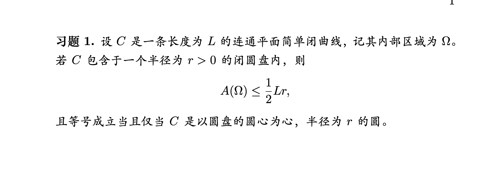

# 第13次作业

来源：[网络学堂原页面](https://learn.tsinghua.edu.cn/)，2025-2026春微分几何。

## 页面作业要求

1. 证明平面简单闭曲线的等周不等式

2. 完成下面习题：

图片直接从作业说明下载，与本地原图SHA256相同；文字要求与图中习题共同构成完整题目。

## 文件角色

上交作业附件、评语附件分开保存。上交稿为个人解答，评语附件为课程批注；没有把个人作业称为标准答案。

> GitHub 版本已省略个人平台链接及本机路径；资料原文件未改写。
