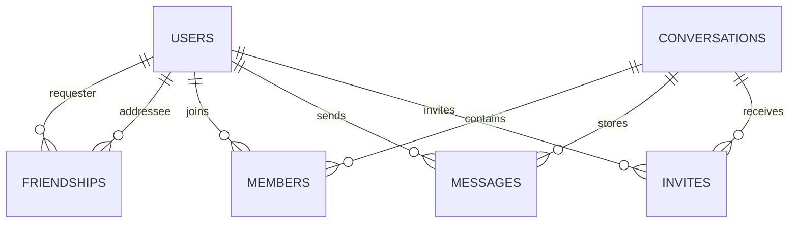

# 数据库与接口设计

## 关系模型

| 表 | 关键字段 | 约束和用途 |
| --- | --- | --- |
| `users` | `id`, `username`, `email`, `password_hash`, `avatar`, `bio` | 邮箱不区分大小写唯一；密码只保存 scrypt 哈希 |
| `friendships` | `requester_id`, `addressee_id`, `status` | 一对用户至多一条申请记录；状态 pending/accepted |
| `conversations` | `id`, `name`, `type`, `owner_id`, `announcement` | type 为 direct 或 group |
| `members` | `conversation_id`, `user_id`, `role`, `read_index` | 复合主键防止重复成员；保存已读消息游标 |
| `messages` | `id`, `conversation_id`, `sender_id`, `body`, `created_at`, `recalled`, `deleted_for` | 自增 ID 兼作稳定消息游标；删除用户列表支持仅自己删除 |
| `invites` | `conversation_id`, `inviter_id`, `invitee_id`, `status` | 群邀请待处理、接受或忽略 |

时间存为 SQLite UTC `datetime('now')` 文本；消息读取按会话 ID 和消息 ID 建索引，以 `before` 游标倒序读取并在客户端还原为正序。

## HTTP API

除健康检查和登录/注册外，均需 `Authorization: Bearer <token>`。

| 方法 | 路径 | 用途 |
| --- | --- | --- |
| GET | `/api/health` | 服务健康状态 |
| POST | `/api/auth/register` | 创建用户，字段 username/email/password |
| POST | `/api/auth/login` | 登录，字段 email/password |
| GET/PATCH | `/api/me` | 当前用户信息/更新名片 |
| GET | `/api/users/search?q=` | 搜索其他用户 |
| GET/POST | `/api/friends` | 好友与申请列表/发送或接受申请 |
| DELETE | `/api/friends/:userId` | 删除好友关系 |
| GET/POST | `/api/conversations` | 会话列表/创建私聊或群聊 |
| GET/POST | `/api/conversations/:id/messages` | 分页读取/发送消息 |
| POST | `/api/conversations/:id/read` | 更新本人已读游标 |
| POST | `/api/conversations/:id/messages/:msgId/recall` | 撤回自己发送的消息 |
| POST | `/api/conversations/:id/messages/:msgId/delete` | 仅从本人记录隐藏消息 |
| GET/POST/DELETE | `/api/conversations/:id/members` | 成员列表/邀请/移除 |
| PATCH | `/api/conversations/:id/announcement` | 更新群公告 |
| POST | `/api/conversations/:id/leave` | 退出群聊 |
| GET | `/api/invites` | 当前用户的待处理群邀请 |
| POST | `/api/invites/:id` | 接受或忽略群邀请 |

## WebSocket

连接：`ws://<host>/ws?token=<token>`。服务端通过连接令牌绑定用户 ID，只向对应在线用户推送事件。事件类型包括 `connected`、`message`、`message_update`、`unread`、`read`、`announcement`、`group_invite`、`friend_request`、`member_left` 和 `removed_from_group`。消息先提交 SQLite，再广播；实时投递失败时消息仍可通过 `GET messages` 补拉。

## 消息生命周期

1. 客户端提交消息到会话消息接口。
2. 服务端校验用户仍是成员，校验正文长度，写入 messages。
3. 更新发送者 `read_index`，并把消息推送给所有在线成员。
4. 收件端保存消息并通过 `/read` 上报自己读到的消息 ID。
5. 断线重连后以会话消息分页接口补齐离线消息。
