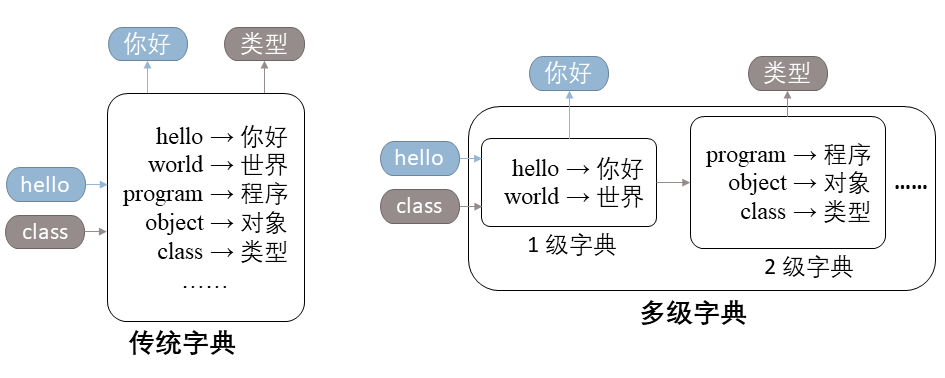

# 多级字典

- 题组：2023OOP期末考试
- 原始页面：https://oj.cs.tsinghua.edu.cn/course/70/contest/823/problem/3

# 多级字典

## 题目背景

小肖的饭店倒闭了，他痛定思痛，决定改行做一名程序员。

最近，小肖在学习字典这种数据结构。我们都知道，字典是存储键值对（Key-value Pair）的数据结构，如下左图中的 `hello` →\rightarrow→ `你好` 即是一个键值对，其中 `hello` 是键（Key），`你好` 是值（Value）。传统的字典允许用户根据键查找对应的值。在 C++ 中，我们可以使用 `std::map` 来构建一个字典。

在学习过程中，小肖突发奇想设计了一种多级字典，在传统字典功能的基础上将字典分为多个层级，并在查询时逐层访问，如下右图所示。具体来说，当我们希望查找一个键值对时，我们会先访问 1 级字典，如果找到，则直接返回结果；否则，我们将继续访问下一级字典，直到找到结果或访问至最后一级字典为止。



在实际应用中，我们可以精心设置各级字典的容量上限，在不同层级中存储不同的键值对，并使用不同的数据结构维护它们，来达到更高的效率。但在本题中，你无需过度关注效率，而是需要实现一个简易的多级字典的模拟器，来帮助小肖统计真实场景下各级字典的命中率。

**我们设置了 4 个任务来引导你循序渐进地完成本题，我们强烈建议你依次完成它们**，当然，你也可以选择直接完成整道题目的完整要求（即子任务 4）。

点击[此处](_downloads/down_%E5%B1%95%E5%BC%80/README.md)下载本题下发文件。

## 子任务 1：支持命中统计的字典（20 分）

**子任务 1、2 之间相互独立，你可以跳过子任务 1 先完成子任务 2。**

请你实现模板类 `template<class Key, class Value> class MyDict`，支持如下接口：

- 下标运算符 `operator[] (key)`：根据键 `key` 返回对应的值的引用。该运算符的行为可以分两种情况讨论。- 命中（Hit）：如果键 `key` 存在于字典中，则直接返回对应值的引用。
- 缺失（Miss）：如果键 `key` 不存在，则使用值类型的默认构造函数进行初始化（即 `Value()`），并返回该引用。
- `hitStats()`（常量成员函数）：返回一个 `HitStatsResult` 类型的对象，记录过去所有下标运算符 `[]` 的访问中，命中 / 缺失的次数。- 我们已经为你实现了 `HitStatsResult` 类，你可以直接使用 `HitStatsResult(hit, miss)` 来构造一个对象，其中 `hit` 和 `miss` 分别代表命中次数和缺失次数。
- `size()`（常量成员函数）：返回字典中存储的键值对数量。
- `clear()`：清空当前字典存储的所有键值对，同时清空访问命中率的统计数据。

提示：上述大部分接口与 `std::map` 类似，因此我们建议你借助 `std::map` 来大大简化你的代码，同时达到足以通过本题的速度。

样例详见下发文件的 `subtask1/` 子目录（提交时请勿包含该子文件夹，而是与平时作业类似直接打包代码文件。详见《提交要求》）。

## 子任务 2：弹出策略（30 分）

在多级字典中，我们常常面临一个问题：某级字典存储的内容超过了容量限制，需要选择一个键值对弹出（Pop）当前字典，并插入下一级字典。

在这个子任务中，你只需要实现 2 种不同的弹出策略：

- `FIFOStrategy`：先进先出（First in First out，FIFO）策略，弹出最早被插入的元素。
- `LRUStrategy`：最近最少使用（Least Recently Used，LRU）策略，弹出最长时间未被访问的元素。

具体地，这 2 种弹出策略应当继承基类 `PopStrategy`，并支持如下接口：

- `visit(key)`：表示一次对键 `key` 的访问。
- `pop()`：按对应规则弹出一个元素，并返回被弹出的键。本题中，我们保证调用 `pop` 操作时至少有 1 个未被弹出的元素。

需要注意的是，所有键只有在首次访问时或移除后首次访问时被视作插入。

下面的代码片段是一个例子，展示了插入、访问、弹出的关系，同时说明了 FIFO 策略与 LRU 策略的差异：

```
FIFOStrategy<char> fifo;
fifo.visit('a');
fifo.visit('b');
fifo.visit('a');
fifo.visit('c');
std::cout << fifo.pop() << std::endl; // 输出为 a，因为 a 是最早被插入的元素
fifo.visit('a');
std::cout << fifo.pop() << std::endl; // 输出为 b，因为弹出 a 后再访问视作重新插入，因此 b 是此时最早被插入的元素

LRUStrategy<char> lru;
lru.visit('a');
lru.visit('b');
lru.visit('a');
lru.visit('c');
std::cout << lru.pop() << std::endl; // 输出为 b，因为 b 是最长时间未被访问的元素
lru.visit('a');
std::cout << lru.pop() << std::endl; // 输出为 c，因为此时 c 是最长时间未被访问的元素
```

假设 NNN 表示某 `PopStrategy` 某一时刻维护的元素数目，那么在本题中，我们保证 N≤32N\leq 32N≤32。例如，在上面的代码段中，NNN 最大时达到 333。

提示：

- 在本题中，你无需过度担心时间效率，只需实现 O(N)O\left(N\right)O(N) 时间复杂度的 `visit` 和 `pop` 函数即可。

样例详见下发文件的 `subtask2/` 子目录（提交时请勿包含该子文件夹，而是与平时作业类似直接打包代码文件。详见《提交要求》）。

## 子任务 3：容量限制（20 分）

基于子任务 1 实现的 `MyDict` 类，请结合子任务 2 实现的不同弹出策略，实现支持容量限制的 `MyDict`。具体地，你需要在子任务 1 需求的基础上额外支持两个构造函数：

- `MyDict()`：默认构造函数，构造一个与子任务 1 要求一致的无容量限制的 `MyDict` 对象。
- `MyDict(int capacity, PopStrategy<Key>* popStrategyPtr)`：构造一个容量上限为 `capacity` 的 `MyDict`，在字典超过容量限制时，使用 `popStrategyPtr` 指向的对象选择一个键值对，将其弹出字典。- 在本题中，我们保证 `capacity` 不超过 323232。

提示：

- 在本题中，字典容量超过限制只有可能在调用下标运算符 `operator[]` 后发生。
- 为了完成这个子任务，你可能需要对子任务 1、2 实现的内容进行修改或补充。

样例详见下发文件的 `subtask3/` 子目录（提交时请勿包含该子文件夹，而是与平时作业类似直接打包代码文件。详见《提交要求》）。

## 子任务 4：多级字典（30 分）

基于子任务 3 的附带容量限制、弹出策略的 `MyDict`，我们可以继续开发得到最终版本的多级字典模拟器。具体地，你需要在子任务 3 的基础上，额外支持构造函数：

- `MyDict(int capacity, PopStrategy<Key>* popStrategyPtr, MyDict* nextLevelPtr)`：构造一个容量上限为 `capacity` 的 `MyDict`，其下一级子字典为 `nextLevelPtr` 指向的对象。在字典超过容量限制时，使用 `popStrategyPtr` 指向的对象选择一个键值对，将其弹出当前字典，并插入下一级子字典。- 在本题中，我们保证 `capacity` 不超过 323232。

对于多级字典，我们对所有接口有如下拓展定义：

- 下标运算符 `operator[] (key)`：根据键 `key` 返回对应的值的引用。与子任务 1 类似地，我们分两种情况讨论其行为。- 命中（Hit）：如果键 `key` 存在于当前字典中，则直接返回对应值的引用。
- 缺失（Miss）：如果键 `key` 不存在于当前字典中，则**在下一级子字典中递归调用 operator[] 查找：**- 若下一级子字典不存在，则使用值类型的默认构造函数进行初始化（即 `Value()`），将其插入当前字典，并返回该引用。
- 否则，在子字典中 **调用 operator[]** 查找后，此时键 `key` 必然存在于子字典中，则将查找到的键值对从子字典中弹出，并插入当前字典后返回其引用。
- 插入之后需要检查当前字典是否超出容量，若超出容量，则使用 `popStrategyPtr` 指向的对象选择一个键值对，将其弹出当前字典，并 **递归调用 operator[]** 插入下一级子字典。
- 例1：共 2 级字典，要查找的键k1k_1k1​存储于 2 级字典，并且 1 级字典已达到容量上限，则整个查找过程如下- 1 级字典缺失k1k_1k1​，此时 1 级字典为当前字典， 2 级字典为子字典，故递归至 2 级字典查找
- 当前字典为 2 级字典，在 2 级字典命中k1k_1k1​，直接返回
- 当前字典为 1 级字典，其子字典为 2 级字典，则将 2 级字典的k1k_1k1​弹出并插入 1 级字典，发现超出 1 级字典容量，弹出键k2k_2k2​至 2 级字典
- 当前字典为 2 级字典，2 级字典缺失k2k_2k2​，由于没有下一级字典，因此使用默认构造函数初始化键k2k_2k2​对应的值并插入 2 级字典，返回其引用
- 将 1 级字典中保存的k2k_2k2​的值赋给上一步中返回的引用
- 1 级字典返回k1k_1k1​对应的值的引用
- 结束，1 级字典记录一次缺失，2 级字典记录一次缺失和一次命中
- 例2：共 2 级字典，均未到达容量上限，要查找的键kkk不在其中，则整个查找过程如下- 1 级字典缺失kkk，递归至 2 级字典查找
- 2 级字典缺失kkk，由于没有下一级字典，因此使用默认构造函数初始化键kkk对应的值并插入 2 级字典，返回其引用
- 将 2 级字典的kkk弹出并插入 1 级字典
- 1 级字典返回kkk对应的值的引用
- 结束，1 级字典记录一次缺失， 2 级字典记录一次缺失
- `hitStats()`（常量成员函数）：返回一个 `HitStatsResult` 类型的对象，记录过去所有下标运算符 `[]` 的访问中，**所有层级字典的命中 / 缺失次数**。- 我们已经为你实现了 `HitStatsResult` 类，你可以直接使用 `HitStatsResult(hitArray, missArray)` 来构造一个对象，其中 `hitArray` 和 `missArray` 分别代表各级字典的命中数和未命中数，使用 `std::vector` 表示，其中 `hitArray[i]`，`missArray[i]` 分别表示第 i+1i+1i+1 级字典的命中次数、缺失次数。
- 你也可以使用 `+` 运算符拼接两个 `HitStatsResult`，如：假设 1 级字典的结果为 `res_1`，2 级字典及其所有子字典的结果为 `res_2`，则你可以使用 `res_1 + res_2` 来得到完整的结果。
- `size()`（常量成员函数）：返回当前字典**及所有子字典**中存储的键值对数量总和。
- `clear()`：清空当前字典**及所有子字典**存储的所有键值对，同时清空它们的命中率统计数据。

提示：本题实现的多级字典仅供模拟使用，因此你不需要过度关注性能。

样例详见下发文件的 `subtask4/` 子目录（提交时请勿包含该子文件夹，而是与平时作业类似直接打包代码文件。详见《提交要求》）。

## 提交要求

不论你想要提交哪些子任务，你都只需要使用 zip 格式打包 `MyDict.hpp`（对于子任务 1、3、4）和 `PopStrategy.hpp`（对于子任务 2、3、4），并提交这个压缩包。**压缩包中不应包含任何子文件夹，换而言之，解压你提交的压缩包，应直接得到上述两个 hpp 文件，而不是包含这两个文件的一个或多个子文件夹。**

你不能修改、也不必提交 `main.cpp`、`Makefile`、`HitStatsResult.hpp`，在评测时，OJ 会将提供的文件贴入你的目录下进行编译并执行。

## 评分规则

本题的子任务**不使用**捆绑测试。具体地，每个子任务都包含 2 个样例测试点和若干个隐藏测试点。**样例测试点与下发文件完全一致**，占子任务 40%40\%40% 的分数；隐藏测试点占子任务剩余 60%60\%60% 的分数。

子任务、测试点编号的对应关系如下：

| 子任务 | 样例测试点编号 | 每个样例测试点分值 | 隐藏测试点编号 | 每个隐藏测试点分值 | 总分值 |
| --- | --- | --- | --- | --- | --- |
| 1 | 1~2 | 4 分 | 3~4 | 6 分 | 20 分 |
| 2 | 5~6 | 6 分 | 7~8 | 9 分 | 30 分 |
| 3 | 9~10 | 4 分 | 11~12 | 6 分 | 20 分 |
| 4 | 13~14 | 6 分 | 15~17 | 6 分 | 30 分 |

本题样例的 Makefile 中定义的宏 `__SUBTASK1__`、`__SUBTASK2__`、`__SUBTASK3__`、`__SUBTASK4__` 在隐藏测例中同样存在。事实上，这些宏并不是完成本题所必要的，但你仍可以利用它们帮助你处理不同的子任务。

## 数据规模及限制

你不需要特别考虑时间、空间效率。具体地，我们保证：

- 测例中的 `MyDict` 至多为 5 级字典。
- 对于任一测例，评测代码调用 `MyDict` 的成员函数（包括构造函数、运算符重载等）的总次数不超过 3×1043 \times 10^43×104 次。- 对于第二个子任务，这一次数限制适用于评测代码显式调用 `PopStrategy` 及其派生类的成员函数。
- 对于所有有容量限制的字典，其容量限制均不超过 323232（即 `capacity` 不超过 32）。这意味着你可以放心大胆地实现单次计算时间复杂度为 O(N)O\left(N\right)O(N) 的弹出策略。
- 我们预置的评测代码的运行时间不超过时间限制的 555% ，内存开销不超过空间限制的 555%；
- 为避免浮点误差造成的影响，本题所有测试点均不包含任何浮点数类型。

**时间限制：1s**

**空间限制：512MB**
