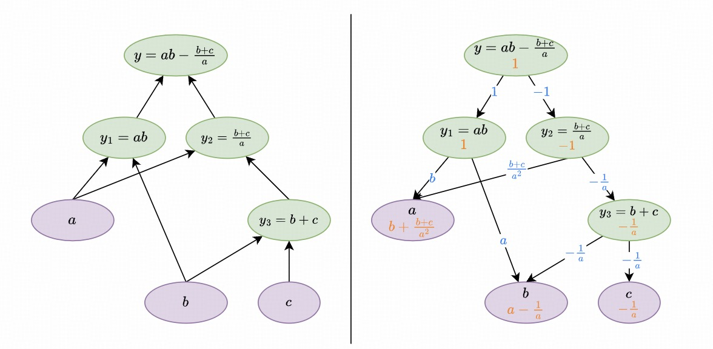

# 计算图

- 题组：2024OOP期末考试
- 原始页面：https://oj.cs.tsinghua.edu.cn/course/70/contest/824/problem/2

[English Version](./en.pdf)

## 题目描述

小S在一家AI公司打工，被要求开发一个简单计算图的框架。然而小S要打的工实在是太多了，作为小S的朋友，你决定帮小S减轻一点负担。你向小S询问了计算图的基本概念：

> 计算图是用于表示数学计算过程的一种有向无环图。在计算图中，节点代表操作（如加减乘除等），或变量（如输入），而边代表这些操作或变量之间的依赖关系。计算图的一个重要应用是自动微分。通过链式法则（若y=f(y1(x),y2(x),⋯ ,yn(x))y=f(y_1(x),y_2(x),\cdots,y_n(x))y=f(y1​(x),y2​(x),⋯,yn​(x))，则dydx=∑i=1ndyidx⋅∂y∂yi\frac{\mathrm{d} y}{\mathrm{d} x}=\sum_{i=1}^n \frac{\mathrm{d} y_i}{\mathrm{d} x} \cdot \frac{\partial y}{\partial y_i}dxdy​=∑i=1n​dxdyi​​⋅∂yi​∂y​），计算图可以支持反向传播算法，高效地计算梯度（即导数），用于训练神经网络。

计算图中包含两类节点：叶节点和非叶节点。叶节点有一个数值，并且需要在反向传播过程中求出其相对于指定节点的梯度；非叶节点是由节点之间进行各种类型的计算得到的，具有若干输入节点和一个输出值，所以也被称为算子。整个算法分为两个部分：

- 第一部分为正向计算过程，在这部分中，节点之间进行各种运算，最后得到一个节点作为结果。
- 第二部分为反向传播过程，在这部分中，梯度从第一部分得到的结果节点开始进行传播：- 对于非叶节点，若其相对于结果节点的梯度为ggg，则它需要计算出其每个输入节点相对于结果节点的梯度，并向这些输入节点递归传播梯度；
- 对于叶节点，它只需将所有非叶节点传播到它的梯度累加起来；
- 算法开始时，梯度从结果节点开始进行传播，显然地，结果节点的梯度为111（因为dydy=1\frac{\mathrm{d} y}{\mathrm{d} y}=1dydy​=1）。

一个计算图的样例如下，左图为正向计算过程，右图为反向传播过程，橙色数表示该节点相对于yyy的梯度，蓝色数表示梯度的传播，最终可以得到∂y∂a=b+b+ca2,;∂y∂b=a−1a,;∂y∂c=−1a\frac{\partial y}{\partial a}=b+\frac{b+c}{a^2},\\; \frac{\partial y}{\partial b}=a-\frac{1}{a},\\; \frac{\partial y}{\partial c}=-\frac{1}{a}∂a∂y​=b+a2b+c​,;∂b∂y​=a−a1​,;∂c∂y​=−a1​。



你不擅长数学，但幸运的是，小S被分配到的任务只要求实现加减乘除四种算子，并且小S已经推导出了这四种算子的反向传播如何计算：

- 对于y=a+by=a+by=a+b，若yyy的梯度为ggg，则a,ba,ba,b的梯度均为ggg。
- 对于y=a−by=a-by=a−b，若yyy的梯度为ggg，则aaa的梯度为ggg，bbb的梯度为−g-g−g。
- 对于y=aby=aby=ab，若yyy的梯度为ggg，则aaa的梯度为gbgbgb，bbb的梯度为gagaga。
- 对于y=aby=\frac{a}{b}y=ba​，若yyy的梯度为ggg，则aaa的梯度为gb\frac{g}{b}bg​，bbb的梯度为−gab2-\frac{ga}{b^2}−b2ga​​。

小S已经在`leaf_node.h`、`leaf_node.cpp`、`node.h`、`node.cpp`写了一些代码，请你阅读并完善这些文件，以实现简单计算图的功能，当然你也可以任意修改这些文件，添加你需要用到的接口或新的类。**由于小S很害怕遗忘，因此你的代码中不允许引起内存泄露。**

为了防止你遗忘了，小S也列出了你需要实现的接口有哪些：

- `Node`类，表示非叶节点：- `float get_val()`，返回一个浮点数表示该节点的值是多少。算法的第一部分时会调用该接口获得正向计算结果；
- `void backward(float g)`，给定该节点的梯度为ggg​，根据算子的类型进行反向传播。算法的第二部分时会在结果节点调用`backward(1.0)`。
- `LeafNode`类，表示叶节点，小S已经贴心地帮你把要用到的接口写好了。
- `+-*/`运算符。

[题目文件下载](_downloads/downloads_%E5%B1%95%E5%BC%80/README.md)

## 测试数据及约定

本题共10个测试点，每个测试点10分。每个测试点有单独的`main.cpp`文件，分别为`main0.cpp`到`main9.cpp`，所有测试点均无输入。

各个测试点约束如下：

- 测试点0、1、2：只包含加减法、只包含正向计算过程、不检查内存泄漏。
- 测试点3、4、5：只包含加减法、不检查内存泄漏。
- 测试点6、7：不检查内存泄漏。
- 测试点8、9：无特殊约束。

其中第0、3、6、8测试点的`main.cpp`文件及对应答案已包含在下发文件中作为样例。

所有测试点中涉及的计算图规模都足够小，因此你无需刻意关注程序的运行速度。

**特别地**，当调用`backward(float)`时，保证所有涉及到的`LeafNode`的生命周期未结束，即你可以认为以下类型的代码不会在测试数据中出现：

```
LeafNode a(3.0);
Node b = a;
if (true) {
  LeafNode c(5.0);
  b = b + c;
}
b.backward(1.0);
```

因为调用`b.backward(1.0)`时，大括号中构造的`c`已经被析构了，故这段代码是非法的。类似地，下面是另一个非法代码的例子：

```
Node b = LeafNode(2.33);
b.backward(1.0);
```

## 提示

小S马上要出门打下一份工了，临走前，小S想了想，留下了一些提示，注意小S的提示并不具有任何强制性：

1. 或许可以考虑实现`LeafNode`到`Node`的隐式类型转换。
2. 或许可以将`Node`类设计成包装器，在`Node`类中保存一个指针指向真正的算子，小S解释了这么做的好处：`Node`之间进行运算的时候并不是指针形态，因此不好直接实现多态，而通过类内保存的指针去实现多态则十分便利。
3. 乘除法和加减法没有很大区别，当你完成前6个测试点后，或许可以很快通过测试点6、7。
4. 或许可以用智能指针进行内存管理，但可能需要设法避免智能指针将`LeafNode`错误地析构了。

## 提交格式

请将`leaf_node.h`、`leaf_node.cpp`、`node.h`、`node.cpp`打包成一个 zip 格式的压缩包并上传，提交的其他文件将被忽略。**注意：你的文件应该在压缩包的根目录下，而不是压缩包的一个子文件夹下，换而言之，解压你提交的压缩包后，应该直接得到一系列 cpp 文件、h 文件等代码文件，而不是一个包含它们的文件夹。**评测时，OJ会将提供的文件贴入你的目录下进行编译并执行。
